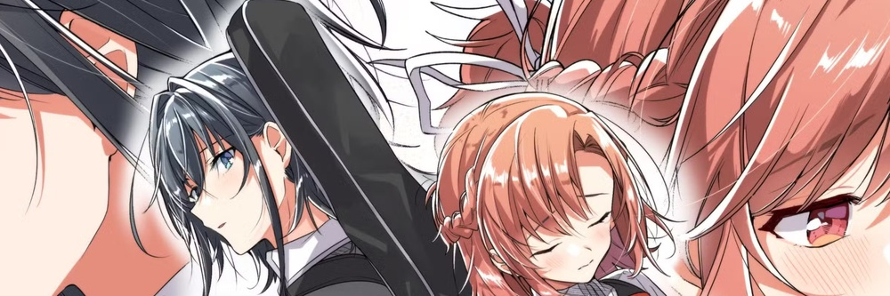
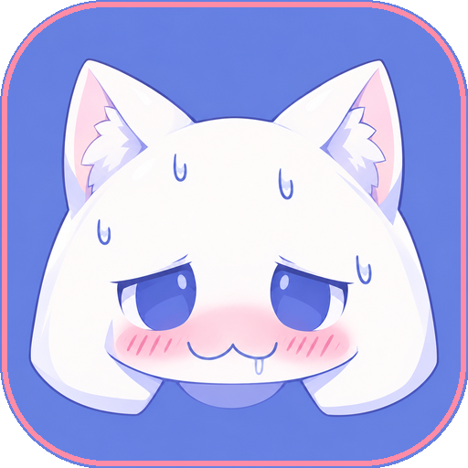
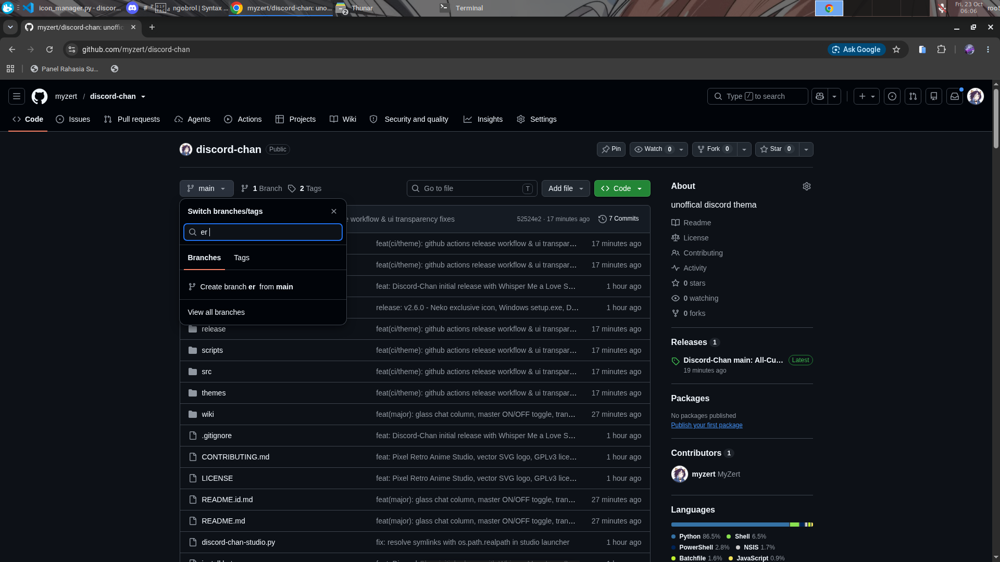
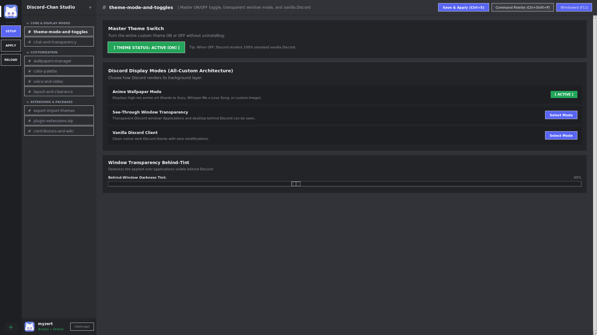

<p align="center">
  
</p>

<p align="center">
  
</p>

<h1 align="center">Discord-Chan Studio: Universal Anime Theme & Extension Center</h1>

<p align="center">
  <b>Panel Kontrol Resmi Bergaya Discord Client, Tema All-Custom & Ekstensi Modular (Linux & Windows)</b><br>
  <i>Saklar Master (ON/OFF) • Mode Transparan Tembus Aplikasi Belakang & Anime • Kolom Chat 100% Kaca • Slider Kelengkungan UI Kotak • Ekstensi Modular ZIP • Ekspor/Impor Tema • GPLv3</i>
</p>

<p align="center">
  <a href="https://github.com/myzert/discord-chan/stargazers"></a>
  <a href="https://github.com/myzert/discord-chan/network/members"></a>
  <a href="https://github.com/myzert/discord-chan/blob/main/LICENSE"></a>
  <a href="https://betterdiscord.app/"></a>
  <a href="#"></a>
  <a href="#"></a>
</p>

<p align="center">
  <b>Bahasa:</b> <a href="README.md"><b>English</b></a> | <b>Bahasa Indonesia</b> | <a href="wiki/Home.md"><b>Wiki Dokumentasi</b></a>
</p>

---

## Catatan Keamanan Penting & Penjelasan (Disclaimer ToS)

> [!IMPORTANT]
> **Discord-Chan adalah 100% Tema Visual CSS Client-Side & BetterDiscord.**
> - **BUKAN MODIFIKASI FITUR NITRO BERBAYAR:** Proyek ini **TIDAK membuka fitur Nitro berbayar** (tidak ada spoof server boost, banner animasi berbayar, dll).
> - **TIDAK MENGUBAH SERVER / BINARY:** Tidak menyentuh token user, tidak ada scraper, dan aman dari pelanggaran API Discord.
> - **100% AMAN DARI BANNED & SESUAI ATURAN (ToS):** Hanya mengubah tampilan visual di komputer kamu sendiri (warna, transparansi kaca, wallpaper anime, dan foto profil chat yang rapi) melalui BetterDiscord.

---

## Perintah Auto-Install Instan (1-Command Setup)

### Linux (Perintah Satu Baris Terminal)
Jalankan perintah ini di terminal Linux kamu:
```bash
curl -fsSL https://raw.githubusercontent.com/myzert/discord-chan/main/install.sh | bash
```

*Atau clone repository secara manual:*
```bash
git clone https://github.com/myzert/discord-chan.git
cd discord-chan
chmod +x install.sh
./install.sh
```

### Windows (Perintah PowerShell)
Buka PowerShell dan jalankan:
```powershell
irm https://raw.githubusercontent.com/myzert/discord-chan/main/install.ps1 | iex
```

*Atau download repositori dan klik dua kali `install.bat`.*

---

## Fitur-Fitur Unggulan Terbaru

| Fitur | Penjelasan |
| :--- | :--- |
| **Saklar Master Tema (ON / OFF)** | Nyalakan atau matikan tema secara instan dengan 1 tombol. Saat dimatikan (OFF), Discord langsung kembali ke tampilan asli bawaan. |
| **3 Pilihan Mode Tampilan** | Pilih antara **Mode Wallpaper Anime**, **Mode Transparan Tembus Aplikasi Belakang** (bisa melihat window & desktop di belakang Discord), atau **Vanilla Discord Bawaan**. |
| **Kolom Chat 100% Transparan Kaca** | Memperbaiki latar abu-abu padat pada kolom chat dengan menimpa token desain Discord. Wallpaper anime terlihat penuh tanpa tertutup. |
| **Kolom Kirim Chat Bergaya Asli** | Kotak pengetikan pesan dirancang seperti Discord asli dengan efek kaca transparan, border aksen saat mengetik, dan tombol lampiran rapi. |
| **Pengatur Kelengkungan Sudut UI (Radius)** | Slider kelengkungan dari tajam `0px` hingga membulat `24px` untuk kotak chat, kartu embed, modal popout, dan tombol. |
| **Perbaikan Warna & Bayangan Embed** | Menghilangkan bayangan kotor yang bikin lag. Kartu embed tampil estetik dengan kaca transparan dan garis aksen warna vertikal di kiri. |
| **Sistem Ekstensi Modular ZIP (Format Chrome)** | Pasang plugin/add-on tambahan berformat `.zip` (`manifest.json` + `style.css`), atau buat template ekstensi baru dengan 1 klik. |
| **Ekspor & Impor Tema (.zip Bundle)** | Bagikan hasil custom temamu ke teman! Mengekspor semua nilai slider, warna hex, dan wallpaper bawaan ke dalam 1 file `.zip`. |
| **Engine Zero-Lag & Anti-Collision** | Menghapus efek `box-shadow` dan `backdrop-filter: blur` yang bikin berat. Dilengkapi jarak atas (`top-spacing`) agar tidak nabrak taskbar. |
| **Pintasan Command Palette (`Ctrl+Shift+P`)** | Buka panel kontrol Studio langsung dari dalam Discord atau desktop kapan saja dengan `Ctrl+Shift+P`. |

---

## Tangkapan Layar & Contoh Tampilan

### 1. Tampilan Discord Tema Anime Kaca


### 2. Panel Kontrol Studio Bergaya Discord


### 3. Icon Maskot Aplikasi
<p align="center">
  
  <br>
  <i>Icon Aplikasi Maskot Discord-Chan Neko (Squircle Alami)</i>
</p>

---

## 3 Mode Tampilan Discord

1. **Mode Wallpaper Anime**
   Pilih dari preset anime resolusi tinggi (*Kaede to Suzu The Animation*, *Whisper Me a Love Song*, *Sakura Minimal*, *Pastel Clouds*, *Neko Mascot*) atau pilih gambar apa saja dari komputermu dengan pratinjau thumbnail langsung.
2. **Mode Transparan Tembus Aplikasi Belakang**
   Menjadikan jendela Discord transparan sehingga aplikasi lain (browser, terminal, editor) dan desktop di belakang Discord terlihat jelas dengan tingkat kegelapan yang bisa diatur.
3. **Mode Vanilla Discord Bawaan**
   Matikan tema custom secara instan untuk kembali ke tampilan asli Discord biasa tanpa uninstall.

---

## Daftar Pintasan Keyboard (Shortcuts di Studio)

| Tombol Pintas | Aksi |
| :--- | :--- |
| `F11` | Mode Layar Penuh (Full Screen) / Jendela Biasa |
| `Ctrl + Shift + P` atau `Ctrl + P` | Buka Quick Command Palette |
| `Ctrl + S` | Simpan & Terapkan Tema langsung ke Discord |
| `Ctrl + R` | Restart Discord dengan flag aman anti-crash |
| `Ctrl + Q` | Keluar dari Discord-Chan Studio |

---

## Pembuat & Kontributor Proyek

### Lead Creator & Maintainer
<p align="center">
  <a href="https://github.com/myzert">
    
  </a>
  <br>
  <b><a href="https://github.com/myzert">myzert</a></b> (<code>zerttcihuy@gmail.com</code>)<br>
  <i>Kreator, Desainer UI, dan Pemimpin Proyek Open-Source</i><br>
  <a href="https://github.com/myzert/discord-chan"></a>
</p>

### Panduan Kontribusi Komunitas
Proyek ini sangat terbuka untuk semua pecinta anime, desainer tema, dan developer!
Baca panduan lengkap di [CONTRIBUTING.md](CONTRIBUTING.md) dan [Wiki Dokumentasi](wiki/Home.md):
- **Beri Star pada repository ini** di pojok kanan atas GitHub!
- **Kirim Wallpaper Anime Baru:** Tambahkan wallpaper anime 16:9 beresolusi tinggi ke folder `assets/wallpapers/`.
- **Buat Ekstensi Baru:** Bungkus custom CSS tambahan ke dalam paket `.zip`.
- **Laporkan Kendala atau Saran:** Buat [Issue baru di GitHub](https://github.com/myzert/discord-chan/issues).

<p align="center">
  <a href="https://github.com/myzert/discord-chan/graphs/contributors">
    
  </a>
</p>

### Riwayat Bintang (Star History)
<p align="center">
  
</p>

---

## Lisensi & Kredit

- **Maskot Discord-Chan:** Didedikasikan untuk komunitas kustomisasi anime Discord.
- **Wallpaper Anime:** *Kaede to Suzu The Animation* dan *Whisper Me a Love Song* (*Sasayaku You ni Koi wo Utau* oleh Eku Takeshima).
- **Pembuat Proyek:** **myzert** (`zerttcihuy@gmail.com`).
- **Lisensi:** Didistribusikan di bawah **[GNU General Public License v3.0 (GPLv3)](LICENSE)**.
