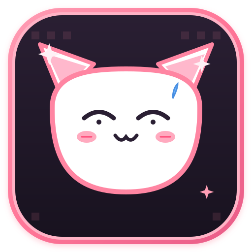

<p align="center">
  
</p>

<p align="center">
  
</p>

<h1 align="center">👾 Discord-Chan: Pixel Retro Anime Studio 🌸</h1>

<p align="center">
  <b>Kustomisasi Discord Tema Anime Pixel Retro 16-Bit & Studio Control Center (Linux & Windows)</b><br>
  <i>Edisi Whisper Me a Love Song (Sasakoi) • Engine Zero-Lag • Logo Vektor SVG • Setup Instan 1-Klik • GPLv3</i>
</p>

<p align="center">
  <a href="https://github.com/myzert/discord-chan/stargazers"></a>
  <a href="https://github.com/myzert/discord-chan/network/members"></a>
  <a href="https://github.com/myzert/discord-chan/blob/main/LICENSE"></a>
  <a href="https://betterdiscord.app/"></a>
  <a href="#"></a>
  <a href="#"></a>
</p>

<p align="center">
  <b>🌐 Bahasa:</b> <a href="README.md"><b>English</b></a> | <b>🇮🇩 Bahasa Indonesia</b>
</p>

---

## 🛡️ Catatan Keamanan Penting & Penjelasan (Disclaimer ToS)

> [!IMPORTANT]
> **Discord-Chan adalah 100% Tema Visual CSS Client-Side & BetterDiscord.**
> - ❌ **BUKAN MODIFIKASI FITUR NITRO BERBAYAR:** Proyek ini **TIDAK membuka fitur Nitro berbayar** (tidak ada spoof server boost, banner animasi berbayar, dll).
> - ❌ **TIDAK MENGUBAH SERVER / BINARY:** Tidak menyentuh token user, tidak ada scraper, dan aman dari pelanggaran API.
> - ✅ **100% AMAN DARI BANNED & SESUAI ATURAN (ToS):** Hanya mengubah tampilan visual di komputer kamu sendiri (warna, wallpaper anime, transparansi, icon aplikasi, dan foto profil chat yang rapi).

---

## 🚀 Perintah Auto-Install Instan (1-Command Setup)

### 🐧 Linux (Perintah Satu Baris Terminal)
Jalankan perintah ini di terminal Linux kamu:
```bash
curl -fsSL https://raw.githubusercontent.com/myzert/discord-chan/main/install.sh | bash
```

*Atau clone repository secara manual:*
```bash
git clone https://github.com/myzert/discord-chan.git
cd discord-chan
chmod +x install.sh
./install.sh
```

### 🪟 Windows (Perintah PowerShell)
Buka PowerShell dan jalankan:
```powershell
irm https://raw.githubusercontent.com/myzert/discord-chan/main/install.ps1 | iex
```

*Atau download repositori dan klik dua kali `install.bat`.*

---

## ✨ Fitur-Fitur Unggulan

| Fitur | Penjelasan |
| :--- | :--- |
| 👾 **Pixel Retro Anime Studio** | GUI panel kontrol bergaya arcade retro 16-bit dengan rendering logo vektor SVG tajam dan efek audio. |
| 🌸 **Tema Anime Whisper Me a Love Song** | Terinspirasi dari serial anime romantis *Sasayaku You ni Koi wo Utau* (Yori & Himari) dengan nuansa pastel pink estetik. |
| ⚡ **Engine Zero-Lag (Tanpa Shadow Berat)** | Menghapus efek `box-shadow` dan `backdrop-filter: blur` yang bikin berat. Menjamin 60 FPS halus di Linux maupun Windows. |
| 🪟 **Pengaturan Transparansi Kaca (Glass UI)** | Slider mandiri untuk tingkat gelap background, transparansi sidebar channel, dan area pesan chat. |
| 📏 **Anti-Nabrak (Top-Spacing Clearance)** | Jarak bersih di bagian atas agar Discord tidak bertabrakan dengan panel taskbar XFCE / GNOME / Windows. |
| 👤 **Perbaikan Foto Profil Chat (Avatar Guard)** | Menjaga grid posisi avatar Discord asli agar tidak rusak, terpotong, atau bergeser saat chat. |
| 🎙️ **Voice Call & Lingkaran Berbicara** | Kotak peserta call transparan (glass tiles), pilihan warna cincin speaking (Sakura Pink, Hijau Emerald, Cyan Neon, Violet Glow), dan tombol kontrol melayang. |
| 🐱 **Icon Aplikasi Discord-Chan Neko** | Icon aplikasi bergaya squircle dengan maskot Discord-chan neko imut dan format vektor SVG. |
| ⌨ **Command Palette Pintas (`Ctrl+Shift+P`)** | Menu pintasan cepat di dalam jendela untuk ganti tema dan perintah instan. |

---

## 📸 Tangkapan Layar & Contoh Tampilan

### 1. Tampilan Discord Minimalist Pink


### 2. Panel Pixel Retro Studio


### 3. Pilihan Icon Aplikasi Anime
<p align="center">
  
  &nbsp;&nbsp;&nbsp;&nbsp;&nbsp;&nbsp;&nbsp;&nbsp;
  
  <br>
  <i>Icon Maskot Discord-Chan Neko (Utama) &nbsp;&bull;&nbsp; Icon Whisper Me a Love Song</i>
</p>

---

## ⌨ Daftar Pintasan Keyboard (Shortcuts di Studio)

| Tombol Pintas | Aksi |
| :--- | :--- |
| `Ctrl + Shift + P` atau `Ctrl + P` | 🌸 Buka Quick Command Palette |
| `Ctrl + S` | ⚡ Simpan & Terapkan Tema langsung ke Discord |
| `Ctrl + R` | 🔄 Restart Discord dengan flag aman anti-crash |
| `Ctrl + O` | 📁 Pilih custom wallpaper anime dari folder sendiri |
| `Ctrl + Q` | ❌ Keluar dari Discord-Chan Studio |

---

## 🎨 Pilihan Palet Warna Siap Pakai

Ganti palet warna secara instan melalui Studio GUI atau Command Palette:
- 🌸 **Sakura Soft** (`#ff85a2` / `#fbcfe8`) - Nuansa pink lembut romantis (Bawaan)
- 🍓 **Strawberry Rose** (`#fb7185` / `#fecdd3`) - Warna merah muda cerah segar
- 🍑 **Pastel Peach** (`#f472b6` / `#fce7f3`) - Nuansa peach hangat
- 🍬 **Cotton Candy** (`#f49ac2` / `#fed7aa`) - Perpaduan warna permen manis
- 🍒 **Cherry Blossom** (`#fda4af` / `#fff1f2`) - Bunga musim semi Jepang
- 💜 **Lavender Yuri** (`#c084fc` / `#e9d5ff`) - Nuansa ungu elegan karakter Yori
- 🖤 **Dark Black-Pink** (`#ff7597` / `#18141c`) - Tema gelap kontras modern

---

## 🤝 Panduan Kontribusi (Kontributor & Bintang ⭐)

Proyek ini sangat terbuka untuk semua pecinta anime, desainer tema, dan developer!
Baca panduan lengkap di [CONTRIBUTING.md](CONTRIBUTING.md).

- 🌟 **Beri Star pada repository ini** di pojok kanan atas GitHub!
- 🖼️ **Kirim Wallpaper Anime Baru:** Tambahkan wallpaper anime 16:9 beresolusi tinggi ke folder `assets/wallpapers/`.
- 🎨 **Kirim Palet Warna Estetik Baru:** Usulkan kombinasi warna baru pada `src/studio.py`.
- 🐛 **Laporkan Kendala atau Saran:** Buat [Issue baru di GitHub](https://github.com/myzert/discord-chan/issues).

---

## 🌟 Daftar Kontributor & Stargazers

<p align="center">
  <a href="https://github.com/myzert/discord-chan/graphs/contributors">
    
  </a>
</p>

### 📈 Riwayat Bintang (Star History)
<p align="center">
  
</p>

---

## 📜 Lisensi & Kredit

- **Karya Seni Anime:** *Whisper Me a Love Song* (*Sasayaku You ni Koi wo Utau*) oleh **Eku Takeshima (竹嶋えく)**.
- **Maskot Discord-Chan:** Didedikasikan untuk komunitas kustomisasi anime Discord.
- **Engine & Desain:** Dikembangkan dengan ❤️ oleh **Discord-Chan Custom Team**.
- **Lisensi:** Didistribusikan di bawah **[GNU General Public License v3.0 (GPLv3)](LICENSE)**.
